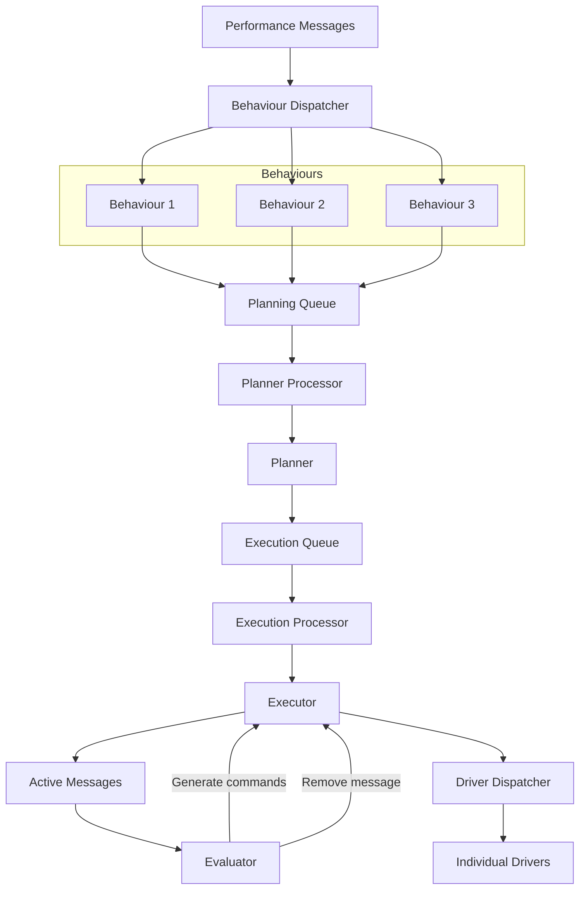
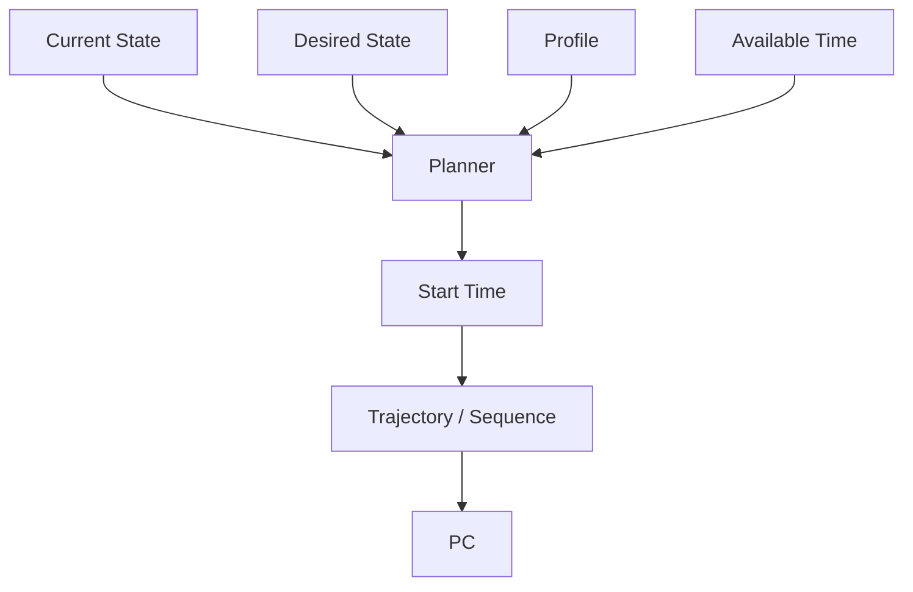
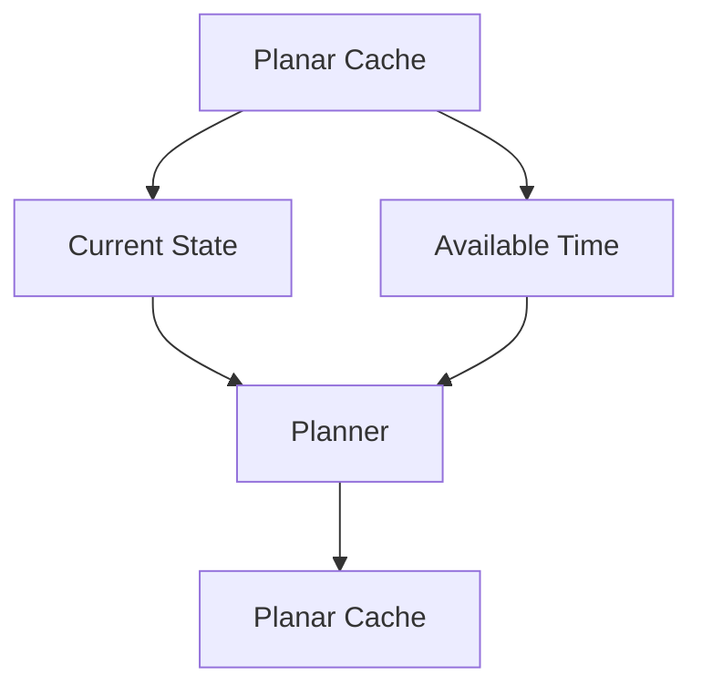

# Software Architecture

## Planning

The Planner takes the PerformanceMessage events and considers the desired state specified by each event's commands, the current state of the affected drivers, the available time, and the desired transition profile. It calculates the start time and the transition profile parameters required to execute the command.

Current state and Available time are based on the last planned event for the driver, which is stored in a cache after the Trajectory / Sequence has been calculated:

